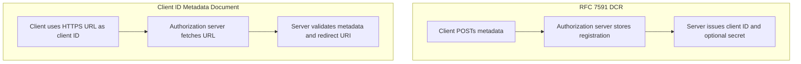

Client ID Metadata Documents (CIMD) let an OAuth client use a stable HTTPS URL as its `client_id`. The authorization server fetches client metadata from that URL instead of creating a registration through RFC 7591.

## Current status

- The MCP draft recommends CIMD and retains DCR for backward compatibility.
- RFC 7591 remains an IETF Standards Track RFC; it is not generally deprecated by OAuth.
- The CIMD specification is still an Internet-Draft and expires February 11, 2027 unless updated.
- Atlassian advertises `client_id_metadata_document_supported: true`.
- No public Cowork or Agents Toolkit procedure was found for publishing, binding, or migrating a CIMD client.

## Credential-model mismatch

Microsoft's current Cowork DCR guidance requires the registration endpoint to issue a client secret. CIMD forbids shared-secret metadata because a public document cannot safely distribute a symmetric secret. A confidential CIMD client instead needs asymmetric authentication such as `private_key_jwt` and a public JWK.

Microsoft must therefore document how Cowork owns a stable Client Identifier URL and corresponding private key before CIMD can replace the current Enterprise Token Store DCR pattern.

## Migration questions

1. Who hosts the stable client metadata URL: Microsoft, the publisher, or the tenant?
2. Which redirect URIs and token authentication methods does Cowork support?
3. How are signing keys created, protected, and rotated?
4. How does a CIMD identity map to a v1.28 connector manifest?
5. Can consent and refresh grants migrate from an existing DCR client ID?