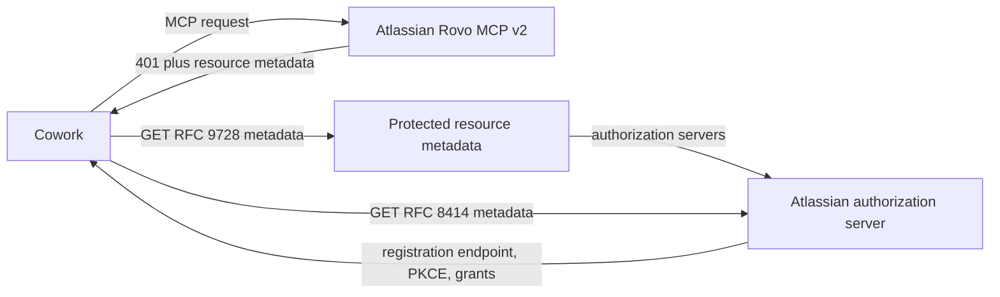
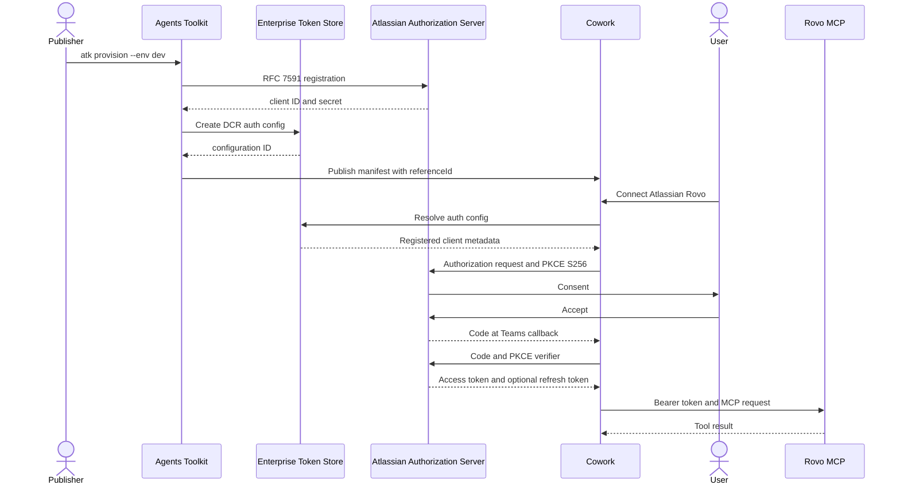

## Discovery chain



For `https://mcp.atlassian.com/v2/mcp`, RFC 9728 path insertion produces:

```text
https://mcp.atlassian.com/.well-known/oauth-protected-resource/v2/mcp
```

That document identifies the resource-specific issuer:

```text
https://auth.atlassian.com/VCeDsk8ZHncYF1g234fKtc4lNipbBhu3
```

## Working provisioning and runtime sequence



## Evidence semantics

- A consent page proves the authorization request and client ID were accepted.
- A callback containing a code proves authorization, not token exchange.
- A successful MCP tool result proves access-token acquisition and presentation.
- A later call after expiry without consent is required to prove refresh behavior.

Never record authorization codes, PKCE verifiers, client secrets, access tokens, refresh tokens, or full OAuth `state` values in evidence.