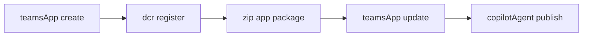

The package contains a unified manifest v1.28 connector, a static Rovo MCP tool catalog, and an idempotent Jira project-tracking skill.

```text
appPackage/
|-- manifest.json
|-- color.png
|-- outline.png
|-- tools/
|   `-- atlassian-rovo-tools.json
`-- skills/
    `-- jira-project-tracking/
        |-- SKILL.md
        `-- references/
            |-- project-tracking-dataset.json
            `-- repro-notes.md
```

The working connector targets `https://mcp.atlassian.com/v2/mcp` and explicitly binds its generated DCR authentication configuration using `OAuthPluginVault.referenceId`.

```json
"remoteMcpServer": {
  "mcpServerUrl": "https://mcp.atlassian.com/v2/mcp",
  "mcpToolDescription": {
    "file": "tools/atlassian-rovo-tools.json"
  },
  "authorization": {
    "type": "OAuthPluginVault",
    "referenceId": "${{ATLASSIAN_ROVO_DCR_V2_CONFIGURATION_ID}}"
  }
}
```

The environment placeholder is resolved during packaging. No client secret or user token belongs in the manifest.

## Lifecycle



The order matters: DCR must generate the reference before Toolkit renders and validates the package.