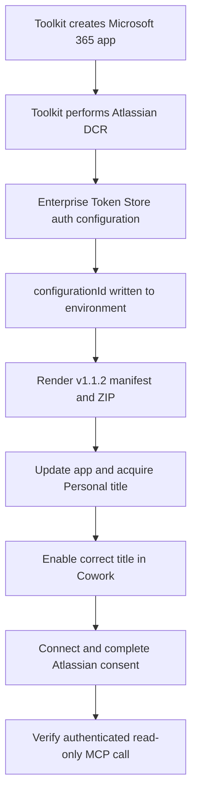

Build **v1.1.2** connects Microsoft 365 Copilot Cowork to the **Atlassian Rovo MCP v2** server using **provisioning-time Dynamic Client Registration (DCR)** and an explicit authentication-configuration reference. This is an independent interoperability reproduction, not an official Atlassian distribution.

:::important Build status
The source is published on [GitHub](https://github.com/dayour/atlassian_cowork). As checked on September 15, 2026, no GitHub Release or downloadable release asset has been published. The generated installation ZIP is local to a provisioned environment and is deliberately excluded from source control. Downloading the repository is not the same as downloading an installable app.
:::

## What changed

| Original failure or ambiguity | Correction used by v1.1.2 | Why it matters |
| --- | --- | --- |
| Import produced a placeholder auth reference without a DCR lifecycle action | Run `dcr/register` before packaging and capture its `configurationId` | The manifest must reference an existing stored authentication configuration |
| Generated manifest ID did not match the app created by Toolkit | Use `${{TEAMS_APP_ID}}` as the manifest `id` | Packaging and update operate on the same registered Microsoft 365 app |
| Tool catalog path was rejected during publication | Use `tools/atlassian-rovo-tools.json`, without leading `./` | The service resolves the exact ZIP-relative path |
| Cowork selected a stale shared v1.1.0 title while Personal v1.1.2 was disabled | Remove the stale test installation and enable the corrected Personal title | A valid new package does not repair a different title's old auth binding |
| Provisioning could recreate duplicate shared and Personal titles | Set `AGENT_SCOPE=personal` for the development environment | Keeps the default reproduction on one intended acquisition scope |

The package's version is `1.1.2`; its unified manifest schema version is `1.28`. These are different version numbers with different purposes. The underlying server URL is `https://mcp.atlassian.com/v2/mcp`.

## Why this is DCR

`OAuthPluginVault` describes how this manifest references stored authentication configuration. It does **not** mean the OAuth client was manually registered. Toolkit's `dcr/register` action creates the client dynamically with Atlassian, creates the Microsoft Enterprise Token Store authentication configuration, and returns the configuration ID that packaging substitutes into the manifest.

There are two distinct phases:

1. **Publisher provisioning:** create the Microsoft 365 app, register the OAuth client, store the authentication configuration, render the manifest, and upload/acquire the package.
2. **User connection:** Cowork resolves the stored configuration, starts the Atlassian authorization flow, and manages the user's OAuth connection. Each user still needs their own Atlassian consent and permissions.



This build does **not** implement automatic runtime DCR by omitting `authorization`. The earlier omitted-auth experiment was confounded by stale title selection. A clean, uniquely identified A/B test is still required before concluding that omission fails universally. See [Findings](../investigation/findings.md) and the [controlled test matrix](test-matrix.md).

## Configuration contract

### Toolkit lifecycle

The following excerpt is from the repository's `m365agents.yml`. Keep DCR after app creation and before `teamsApp/zipAppPackage`:

```yaml
version: v1.13
environmentFolderPath: ./env

provision:
  - uses: teamsApp/create
    with:
      name: atlassian-rovo${{APP_NAME_SUFFIX}}
    writeToEnvironmentFile:
      teamsAppId: TEAMS_APP_ID

  - uses: dcr/register
    with:
      name: Atlassian Rovo MCP v2
      appId: ${{TEAMS_APP_ID}}
      applicableToApps: AnyApp
      targetAudience: AnyTenant
      wellKnownAuthorizationServer: https://auth.atlassian.com/VCeDsk8ZHncYF1g234fKtc4lNipbBhu3/.well-known/oauth-authorization-server
      targetUrlsShouldStartWith:
        - https://mcp.atlassian.com/v2/mcp
    writeToEnvironmentFile:
      configurationId: ATLASSIAN_ROVO_DCR_V2_CONFIGURATION_ID
```

This excerpt is not a replacement for the full lifecycle. The remaining actions package the app, update it, and acquire a title through `copilotAgent/publish`. Inspect the [complete lifecycle](https://github.com/dayour/atlassian_cowork/blob/main/m365agents.yml) before running it.

| Setting | Role and caution |
| --- | --- |
| `appId` | Associates registration with the app created by Toolkit |
| `wellKnownAuthorizationServer` | Atlassian's resource-specific v2 authorization-server metadata URL, not the MCP tool endpoint |
| `targetUrlsShouldStartWith` | Limits the configured URL prefix to the Rovo MCP v2 endpoint |
| `applicableToApps: AnyApp` | Broad app applicability used in this reproduction; review before wider distribution |
| `targetAudience: AnyTenant` | Broad audience setting used here; it neither installs the app in other tenants nor grants Jira access |
| `configurationId` output | Stored in the environment and substituted into the manifest; not a user access token |

The observed OAuth redirect URI was `https://teams.microsoft.com/api/platform/v1.0/oAuthRedirect`, with PKCE `S256`. Toolkit and the platform manage this flow; do not replace the callback with the GitHub Pages URL or manually copy OAuth codes into files.

### Unified manifest

The relevant source fields in `appPackage/manifest.json` are:

```json
{
  "manifestVersion": "1.28",
  "version": "1.1.2",
  "id": "${{TEAMS_APP_ID}}"
}
```

Inside `agentConnectors[].toolSource`, the server configuration is:

```json
{
  "remoteMcpServer": {
    "mcpServerUrl": "https://mcp.atlassian.com/v2/mcp",
    "mcpToolDescription": {
      "file": "tools/atlassian-rovo-tools.json"
    },
    "authorization": {
      "type": "OAuthPluginVault",
      "referenceId": "${{ATLASSIAN_ROVO_DCR_V2_CONFIGURATION_ID}}"
    }
  }
}
```

These are excerpts, not standalone manifests. Preserve the icons, app metadata, connector wrapper, and `agentSkills` entries in the complete file. This unified manifest uses camel-case `referenceId`; examples for separate API plugin manifest formats can use `reference_id`. Do not interchange their schemas or switch auth types based on an example for a different manifest surface.

### Environment files

Start with the checked-in `env/.env.dev.example`. Its defaults are `TEAMSFX_ENV=dev`, `APP_NAME_SUFFIX=dev`, and `AGENT_SCOPE=personal`. Leave generated fields empty on the first run.

| Variable | Populated by / purpose |
| --- | --- |
| `TEAMS_APP_ID` | `teamsApp/create`; manifest app identity |
| `ATLASSIAN_ROVO_DCR_V2_CONFIGURATION_ID` | `dcr/register`; stored auth reference |
| `M365_TITLE_ID` | Personal acquisition; useful when distinguishing duplicate titles |
| `M365_APP_ID` | Microsoft 365 app identity returned by acquisition |
| `SHARE_LINK` | Acquisition output; availability depends on the service and scope |
| `TEAMS_APP_TENANT_ID` | Toolkit-generated tenant context |

Do not reuse this project's operator-specific environment values in a different tenant. Do not commit `env/.env.dev`, `env/.env.dev.user`, generated packages, authorization URLs with state or codes, client secrets, or tokens. Do not erase a valid DCR reference merely to retry packaging; that can lead to unnecessary new registrations.

## Build and install for Personal testing

### 1. Prepare the environment

Use a Microsoft 365 test tenant with Cowork access and custom app acquisition permitted by policy, plus an Atlassian account with access to the intended Jira Cloud site. Admin approval may be required. This workflow was exercised with Agents Toolkit CLI `1.1.16`; Node.js 22 is used by the documentation CI.

```powershell
git clone https://github.com/dayour/atlassian_cowork.git
Set-Location atlassian_cowork
npm install --global @microsoft/m365agentstoolkit-cli@1.1.16
atk --version
```

The checked-in package reports version 1.1.2. Cloning `main` is not a version-pinned GitHub Release. Record the commit with `git rev-parse HEAD` for repeatable testing. `npm ci` and `npm run build` are needed to build the documentation, not to host the remote Atlassian MCP server.

For a fresh checkout only, create the local environment file without overwriting an existing one:

```powershell
if (-not (Test-Path env/.env.dev)) {
    Copy-Item env/.env.dev.example env/.env.dev
}
atk auth login m365
atk auth list
```

Confirm that Toolkit is signed into the intended test tenant and that `AGENT_SCOPE=personal` is set in the local environment file.

### 2. Provision, upload, and acquire

```powershell
atk provision --env dev --interactive false
atk validate --env dev --interactive false
```

:::warning This command changes tenant state
In this repository, `atk provision` does more than build a ZIP. It creates or resolves the app, performs DCR, packages the manifest, updates the registered app, and invokes `copilotAgent/publish` with the configured Personal scope. Run it only in an authorized test environment. There is no separate custom MCP backend to deploy with `atk deploy`.
:::

The generated installation artifact is `appPackage/build/appPackage.dev.zip`. Before using or distributing it, confirm that validation succeeds and inspect it locally:

- `manifest.json` is at the ZIP root, alongside the icons and the expected `tools/` and `skills/` folders.
- The manifest reports app version `1.1.2` and schema `1.28`.
- App ID and auth reference are resolved values, not literal `${{...}}` placeholders.
- The tool path is exactly `tools/atlassian-rovo-tools.json` and that ZIP entry exists.
- The Jira skill and its reference dataset are included.
- No environment files, logs, tokens, or secrets are present.

To regenerate a ZIP after an approved source change without running the full provisioning lifecycle:

```powershell
atk package --env dev --interactive false
atk validate --env dev --interactive false
```

Packaging alone does not register a client, replace an installed title, or grant consent. The environment must already contain the correct app ID and DCR configuration reference. Use the CLI-reported output path when invoking packaging separately.

### 3. Enable and connect in Cowork

1. Open [Microsoft 365 Copilot](https://m365.cloud.microsoft.com/) with the same test account and enter Cowork.
2. Open the available plugin/connector management surface. Labels and placement can vary by rollout.
3. Locate the Personal **Atlassian Rovo** entry associated with the new app/title. Check its version where available; the display name alone is not sufficient.
4. Disable or remove the stale duplicate **test** installation only after confirming its identity. Do not remove unrelated or organization-managed apps.
5. Enable the corrected entry and select **Connect**.
6. Allow the OAuth popup from the originating Cowork page, select the intended Atlassian account/site, and review and accept consent.
7. Return to the original Cowork page and confirm that the connection completes.

Do not replay the authorization URL in an unrelated tab. In the automated reproduction, the standalone callback lacked the originating popup context and ended with `Connection Didn't Complete`. Successful consent and an authorization-code callback alone do not prove token exchange or persistence.

### 4. Verify with read-only operations

Start a new Cowork task with the corrected connector enabled:

```text
Use the Atlassian Rovo connector to call getAccessibleAtlassianResources.
List the accessible site names and URLs. Do not create, update, or delete anything.
```

Confirm the expected site, then ask the connector to discover the Jira search operation and execute a read-only query:

```jql
project in (SWE, KAN)
AND labels = "cowork-rovo-repro"
ORDER BY project, key
```

Use those project keys only where the reproduction dataset exists. A new tenant/site does not automatically contain the 20 seed records. Empty search results can be valid; an authentication error is different from an empty dataset. See [queries](../reference/queries.md) and [Jira skill and data](../reference/jira-skill-and-data.md) for discovery, idempotent seeding, and write-confirmation rules.

## Manual upload and tenant publication

### Manual ZIP upload

For an authorized environment that requires manual sideloading, use the generated, validated ZIP, not a GitHub source-code archive or the unrendered `appPackage/` directory. A source archive has repository nesting and unresolved variables and is not an installation package.

Where the tenant exposes it, use the Microsoft Teams custom-app upload surface (typically **Apps > Manage your apps > Upload an app > Upload a custom app**) and select the generated ZIP. The exact controls depend on tenant policy and client version. A successful Teams upload is not by itself proof of Cowork acquisition or visibility; verify the title in Cowork and complete the connection checks above. The tested route for this reproduction is Toolkit's Personal acquisition lifecycle.

Do not upload the same build through multiple scopes merely to make it appear. That can recreate the duplicate-title problem. If custom upload is unavailable, ask the tenant administrator to approve the supported acquisition route rather than trying to bypass the restriction.

### Tenant-wide publication

After authorized Personal testing, an administrator or appropriately authorized publisher can run the repository's explicit publication lifecycle:

```powershell
atk publish --env dev --interactive false
```

Unlike provisioning, this lifecycle hardcodes `scope: tenant`; changing `AGENT_SCOPE` does not restrict it to Personal. It packages the app, updates it, and calls `copilotAgent/publish` for the tenant, writing `M365_PUBLISHED_TITLE_ID` and `M365_PUBLISHED_APP_ID`. It does not contain a `dcr/register` step, so the environment must already have a valid binding. Tenant approvals and propagation still apply, and each user must connect their own Atlassian account. Tenant-wide publication was not the validated scope for this reproduction.

### GitHub distribution

A GitHub Release and a Microsoft 365 installation are separate operations. Creating a release does not register OAuth clients, upload a tenant app, or grant user consent. Before publishing a ZIP as a release asset, establish its intended audience, confirm the auth configuration's supported distribution scope, inspect the contents, and state exactly which provisioning context it requires. Do not describe a tenant-bound ZIP as a universal installer.

For independent reproducers, the currently supported distribution is source plus the provisioning instructions above. Each publisher creates their own app and DCR configuration. No ready-to-install GitHub Release is claimed by this guide.

## Verification and limitations

| Check | Evidence for v1.1.2 |
| --- | --- |
| Toolkit DCR registration and auth-config creation | Verified in the test environment |
| Generated package and manifest validation | Passed Agents Toolkit validation |
| Correct title resolves an authorization URL with dynamic client ID and PKCE `S256` | Verified after stale-title cleanup |
| Atlassian consent and authorization-code callback | Verified |
| Authenticated Rovo MCP tool invocation | Reported working by the project owner; the automated browser did not capture the full token exchange |
| Access-token expiry and silent refresh | Not captured; `offline_access` and `refresh_token` metadata establish capability only |
| Omitted-authorization automatic runtime DCR | Not isolated in a clean A/B experiment |
| Tenant-wide or cross-tenant distribution | Not established by the Personal-scope reproduction |
| Cowork CIMD configuration | No supported configuration path identified in the reviewed Microsoft guidance |

For a fresh run, record the CLI version, commit, package version, acquisition scope, timestamp, and sanitized test results. Keep app/title/configuration identifiers in private evidence, and never record raw codes or tokens in public issues. A connected badge should be followed by a successful tool call before declaring end-to-end success.

## Troubleshooting and updates

- **Placeholder or missing auth reference:** confirm DCR succeeded and populated the expected environment variable before packaging. Do not fabricate a configuration ID.
- **App update ID mismatch:** verify the rendered manifest ID matches `TEAMS_APP_ID` in the same environment used for provisioning.
- **Tool file missing:** inspect ZIP entries and the exact catalog path; a leading `./` was rejected in this reproduction.
- **Consent completes but Cowork does not connect:** preserve the original popup/opener flow and verify the enabled title's identity and version.
- **Old behavior after upload:** distinguish stale titles and scopes before registering another client. Allow catalog propagation and start a fresh task.
- **Updated package rejected at the same version:** increment the app version for a new published build. A modified successor should not continue to claim it is the unchanged v1.1.2 artifact.
- **Failure after token expiry:** collect sanitized timing and reconnect observations; do not claim refresh works based only on discovery metadata.

See [troubleshooting](troubleshooting.md), the [OAuth and DCR sequence](../investigation/protocol-flow.md), [refresh-token analysis](../investigation/refresh-tokens.md), and [sources and evidence](../reference/sources.md) for supporting detail.
